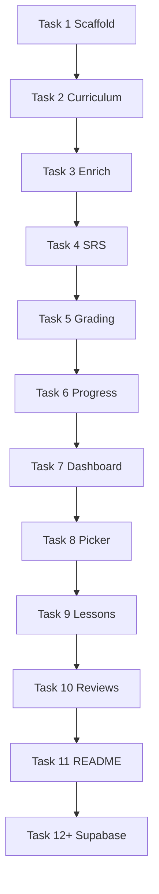

# Oyster MVP (local-first) Implementation Plan

> **For agentic workers:** REQUIRED SUB-SKILL: Use superpowers:subagent-driven-development (recommended) or superpowers:executing-plans to implement this plan task-by-task. Steps use checkbox (`- [ ]`) syntax for tracking.

**Goal:** Rodar localmente um MVP de SRS estilo WaniKani para kanji do Kanji Master N4, com currículo em JSON, motor SRS testado, UI de lições/revisões e progresso em `localStorage` — depois conectar Supabase sem mudar a UI.

**Architecture:** Next.js App Router com camada `lib/srs` pura (testável com Vitest), `lib/progress` com adapter (`local` → `supabase`), dados estáticos em `data/kanji-master-n4/`, páginas em `app/` (dashboard, study picker, lessons, reviews). Enriquecimento KANJIDIC via script Node em build/dev.

**Tech Stack:** Node 20+, pnpm, Next.js 15, React 19, TypeScript, Tailwind CSS 4, Vitest, wanakana, kanjidic2-json, Supabase (fase 2 apenas).

**Spec:** `docs/superpowers/specs/2026-10-18-oyster-design.md`

## Global Constraints

- UI copy em **português (PT-BR)**.
- Significados aceitos na revisão: lista `meaningsPt` + sinônimos opcionais por kanji em JSON.
- Leituras aceitas: união de `onReadings` e `kunReadings` em hiragana (normalizadas).
- Não commitar PDFs/scans do Kanji Master.
- pnpm como package manager.
- Commits pequenos por task (conforme steps).

## Review Focus

| Risco | Comportamento esperado | Teste |
|-------|------------------------|-------|
| Resposta com espaços/全角 | `" ねこ "` e variações devem contar como corretas | `normalizeAnswer` + `gradeReading` em Vitest |
| Múltiplas leituras válidas | Aceitar qualquer leitura listada para aquele kanji | `gradeReading` com 2 kun |
| Revisão antes de `next_review_at` | Não entrar na fila “due” | `getDueKanjiIds` com clock fixo |
| Erro no estágio 1 | Permanece estágio 1, `next_review_at` recalculado | `applyReviewResult` |
| Progresso sem login | `localStorage` key versionada; migração v1→v2 | teste adapter local |
| Capítulo sem kanji enriquecido | Script seed falha com lista explícita de chars faltando | `scripts/enrich-kanji.ts` exit 1 |

---

## Pré-requisitos (você, uma vez)

- [ ] **Step 1:** Instalar Node 20+ e pnpm (`corepack enable && corepack prepare pnpm@latest --activate`).
- [ ] **Step 2:** Na raiz do repo, confirmar pasta vazia exceto `docs/` (`ls`).
- [ ] **Step 3:** Abrir o Kanji Master N4 no **Capítulo 1** e anotar os kanji da **primeira subseção** (lista exata de caracteres) — colar depois em `data/kanji-master-n4/chapters.json`.

**Verificação:** Node `node -v` ≥ 20; pnpm `pnpm -v`.

---

## File map (visão geral)

```
oyster/
├── app/
│   ├── layout.tsx
│   ├── page.tsx                 # dashboard
│   ├── study/page.tsx           # picker capítulo/seção
│   ├── lessons/page.tsx
│   └── reviews/page.tsx
├── components/
│   ├── kanji-card.tsx
│   ├── review-prompt.tsx
│   └── section-picker.tsx
├── data/kanji-master-n4/
│   ├── chapters.json            # estrutura livro (manual)
│   └── kanji.enriched.json      # gerado (gitignore opcional ou commitado)
├── lib/
│   ├── curriculum.ts            # load chapters + filter
│   ├── kanji-types.ts
│   ├── srs/
│   │   ├── intervals.ts
│   │   ├── queue.ts
│   │   └── grade.ts
│   ├── progress/
│   │   ├── types.ts
│   │   ├── local-adapter.ts
│   │   └── index.ts
│   └── answer/
│       └── normalize.ts
├── scripts/
│   └── enrich-kanji.ts
├── tests/
│   └── lib/srs/*.test.ts
├── docs/...
├── package.json
├── vitest.config.ts
└── .env.local.example
```

---

### Task 1: Scaffold Next.js + tooling

**Files:**
- Create: projeto Next (`package.json`, `app/*`, `tsconfig.json`, `tailwind.config.*`)
- Create: `vitest.config.ts`
- Create: `.env.local.example`
- Create: `.gitignore`

**Interfaces:**
- Produces: `pnpm dev` sobe em `http://localhost:3000`

- [ ] **Step 1:** Na raiz `oyster`, rodar:

```bash
pnpm create next-app@latest . --typescript --tailwind --eslint --app --src-dir=false --import-alias="@/*" --turbopack
```

(Se pedir sobrescrever, manter `docs/`.)

- [ ] **Step 2:** Adicionar Vitest:

```bash
pnpm add -D vitest @vitejs/plugin-react jsdom @testing-library/react @testing-library/dom
```

- [ ] **Step 3:** Criar `vitest.config.ts`:

```ts
import { defineConfig } from "vitest/config";
import path from "path";

export default defineConfig({
  test: { environment: "node", include: ["tests/**/*.test.ts"] },
  resolve: { alias: { "@": path.resolve(__dirname, ".") } },
});
```

- [ ] **Step 4:** Em `package.json`, scripts:

```json
"test": "vitest run",
"test:watch": "vitest"
```

- [ ] **Step 5:** Rodar `pnpm dev` — página default abre.

- [ ] **Step 6:** Commit `chore: scaffold Next.js and Vitest`

---

### Task 2: Tipos e currículo N4 (Cap. 1 mínimo)

**Files:**
- Create: `lib/kanji-types.ts`
- Create: `data/kanji-master-n4/chapters.json`
- Create: `lib/curriculum.ts`
- Test: `tests/lib/curriculum.test.ts`

**Interfaces:**
- Produces:
  - `export type KanjiId = string` (ex: `"km-n4-食"`)
  - `export interface Section { id: string; titleJa: string; titlePt: string; kanjiIds: KanjiId[] }`
  - `export interface Chapter { id: string; number: number; titleJa: string; titlePt: string; sections: Section[] }`
  - `export function getChapters(): Chapter[]`
  - `export function resolveKanjiIds(sectionIds: string[]): KanjiId[]`

- [ ] **Step 1:** Escrever teste falhando `getChapters` retorna ≥1 capítulo com id `ch-01`.

- [ ] **Step 2:** Implementar `chapters.json` mínimo:

```json
{
  "book": "kanji-master-n4",
  "chapters": [
    {
      "id": "ch-01",
      "number": 1,
      "titleJa": "生活",
      "titlePt": "Vida cotidiana",
      "sections": [
        {
          "id": "ch-01-s01",
          "titleJa": "（subseção 1 — ajustar título no livro）",
          "titlePt": "Subseção 1",
          "kanjiIds": ["km-n4-食", "km-n4-飲"]
        }
      ]
    }
  ]
}
```

Substituir `kanjiIds` pelos caracteres reais da sua subseção (`km-n4-{char}`).

- [ ] **Step 3:** Implementar `lib/curriculum.ts` e fazer testes passarem.

- [ ] **Step 4:** `pnpm test` PASS.

- [ ] **Step 5:** Commit `feat: N4 chapter schema and curriculum loader`

---

### Task 3: Script enrich KANJIDIC

**Files:**
- Create: `scripts/enrich-kanji.ts`
- Create: `lib/kanji-types.ts` (extend `KanjiEntry`)
- Create: `data/kanji-master-n4/kanji.enriched.json` (gerado)
- Modify: `package.json` script `"enrich:kanji": "tsx scripts/enrich-kanji.ts"`

**Interfaces:**
- Produces: `KanjiEntry` com `character`, `meaningsPt[]` (mapear de EN provisório ou glossário fixo), `onReadings`, `kunReadings`

- [ ] **Step 1:** `pnpm add -D tsx` e `pnpm add kanjidic2-json`

- [ ] **Step 2:** Script: ler todos `kanjiIds` de `chapters.json`, extrair caractere, buscar em KANJIDIC, escrever `kanji.enriched.json`. Se char ausente, `process.exit(1)` listando faltantes.

- [ ] **Step 3:** Mapeamento PT MVP: arquivo `data/kanji-master-n4/meanings-pt.overrides.json` `{ "食": ["comer", "comida"] }` mesclado sobre significados EN do KANJIDIC.

- [ ] **Step 4:** Rodar `pnpm enrich:kanji` — JSON gerado com seus kanji.

- [ ] **Step 5:** `lib/curriculum.ts` → `getKanjiById(id): KanjiEntry`

- [ ] **Step 6:** Commit `feat: enrich kanji from KANJIDIC with PT overrides`

---

### Task 4: Motor SRS (puro, testado)

**Files:**
- Create: `lib/srs/intervals.ts`
- Create: `lib/srs/queue.ts`
- Create: `lib/srs/grade.ts`
- Create: `lib/progress/types.ts`
- Test: `tests/lib/srs/grade.test.ts`, `tests/lib/srs/queue.test.ts`

**Interfaces:**
- Produces:
  - `export const SRS_STAGE_MAX = 8`
  - `export function hoursUntilNextReview(stage: number): number | null` (`null` se burned)
  - `export function applyReview(stage: number, correct: boolean): number`
  - `export function computeNextReviewAt(stage: number, now: Date): Date | null`
  - `export function isDue(progress: UserKanjiProgress, now: Date): boolean`

- [ ] **Step 1:** Testes para intervalos estágio 1→4 e burned estágio 8.

- [ ] **Step 2:** Testes `applyReview`: correto 3→4; incorreto 3→2; incorreto 1→1.

- [ ] **Step 3:** Implementar módulos até `pnpm test` PASS.

- [ ] **Step 4:** Commit `feat: WaniKani-inspired SRS engine`

---

### Task 5: Normalização de respostas + grading

**Files:**
- Create: `lib/answer/normalize.ts`
- Extend: `lib/srs/grade.ts` → `gradeMeaning`, `gradeReading`
- Test: `tests/lib/answer/normalize.test.ts`, `tests/lib/srs/grade-answer.test.ts`

**Interfaces:**
- Produces:
  - `export function normalizeAnswer(input: string): string`
  - `export function gradeMeaning(input: string, accepted: string[]): boolean`
  - `export function gradeReading(input: string, accepted: string[]): boolean`

- [ ] **Step 1:** `normalizeAnswer`: trim, lowercase, NFKC, remover pontuação leve.

- [ ] **Step 2:** `gradeMeaning`: match exato ou item em `accepted` após normalize.

- [ ] **Step 3:** `gradeReading`: usar `wanakana` — `pnpm add wanakana`; converter input para hiragana antes de comparar.

- [ ] **Step 4:** Testes com `"ビョウ"` vs leitura em katakana input convertida.

- [ ] **Step 5:** Commit `feat: answer normalization and grading`

---

### Task 6: Progress adapter (localStorage)

**Files:**
- Create: `lib/progress/local-adapter.ts`
- Create: `lib/progress/index.ts`
- Test: `tests/lib/progress/local-adapter.test.ts` (mock `globalThis.localStorage` ou extrair storage interface)

**Interfaces:**
- Produces:
  - `export interface ProgressStore { get(kanjiId): UserKanjiProgress | null; upsert(p): void; list(): UserKanjiProgress[] }`
  - `export function createLocalProgressStore(): ProgressStore`
  - Key: `oyster-progress-v1`

- [ ] **Step 1:** Teste round-trip upsert + list.

- [ ] **Step 2:** Implementar adapter (somente client-safe; usar em `"use client"` pages).

- [ ] **Step 3:** Helpers: `startLesson(kanjiId)` → stage 1 + `nextReviewAt`; `recordReview(kanjiId, kind, correct)`.

- [ ] **Step 4:** Commit `feat: localStorage progress store`

---

### Task 7: UI — Dashboard (`app/page.tsx`)

**Files:**
- Create: `app/page.tsx` (replace)
- Create: `components/due-count.tsx` (client)

**Interfaces:**
- Consumes: `createLocalProgressStore`, `getDueKanjiIds` (implementar em `lib/srs/queue.ts`)

- [ ] **Step 1:** Mostrar título **Oyster**, contagem “Revisões disponíveis: N”.

- [ ] **Step 2:** Links: `/study`, `/lessons`, `/reviews` (desabilitar lessons/reviews se N=0 e sem lições pendentes).

- [ ] **Step 3:** Verificar manualmente em `pnpm dev`.

- [ ] **Step 4:** Commit `feat: dashboard with due review count`

---

### Task 8: UI — Seletor de estudo

**Files:**
- Create: `app/study/page.tsx`
- Create: `components/section-picker.tsx`
- Create: `lib/study-selection.ts` (persistir seções ativas em `sessionStorage` key `oyster-active-sections`)

**Interfaces:**
- Produces: `export function getActiveKanjiIds(): KanjiId[]`

- [ ] **Step 1:** Listar capítulos/seções com checkboxes.

- [ ] **Step 2:** Botão “Salvar seleção” → `sessionStorage`.

- [ ] **Step 3:** Mostrar preview: quantos kanji e quantos já iniciados no progresso.

- [ ] **Step 4:** Commit `feat: chapter and section study picker`

---

### Task 9: UI — Lições

**Files:**
- Create: `app/lessons/page.tsx`
- Create: `components/kanji-card.tsx`

**Interfaces:**
- Consumes: `getActiveKanjiIds`, kanji não presentes em progress ou stage 0 (definir `NOT_STARTED`)

- [ ] **Step 1:** Fila de até **5** kanji novos por sessão (const `LESSON_BATCH = 5`).

- [ ] **Step 2:** Cartão: caractere grande, significados PT, on/kun, contador “1/5”.

- [ ] **Step 3:** Botão “Próximo” / “Aprendi” → `startLesson` no store.

- [ ] **Step 4:** Ao terminar lote, redirect `/` com toast simples (texto).

- [ ] **Step 5:** Commit `feat: lesson flow for new kanji`

---

### Task 10: UI — Revisões

**Files:**
- Create: `app/reviews/page.tsx`
- Create: `components/review-prompt.tsx`

**Interfaces:**
- Consumes: `gradeMeaning`, `gradeReading`, interleaving simples: alternar tipo por item (`meaning` | `reading`)

- [ ] **Step 1:** Montar fila: todos kanji `isDue` da seleção ativa (ou global se vazio → todos com progress).

- [ ] **Step 2:** Um prompt por vez; input + Enter; feedback verde/vermelho; mostrar resposta correta se errar.

- [ ] **Step 3:** Atualizar progresso após cada resposta.

- [ ] **Step 4:** Sessão termina quando fila vazia → link home.

- [ ] **Step 5:** Commit `feat: typed review sessions`

---

### Task 11: Polish local + README

**Files:**
- Create: `README.md`
- Create: `docs/LICENSE-DATA.md`
- Modify: `app/layout.tsx` (metadata, lang `pt-BR`)

- [ ] **Step 1:** README com: pré-requisitos, `pnpm install`, `pnpm enrich:kanji`, `pnpm dev`, `pnpm test`.

- [ ] **Step 2:** Documentar como adicionar kanji ao `chapters.json`.

- [ ] **Step 3:** Estilo mínimo legível mobile (padding, `text-4xl` no kanji).

- [ ] **Step 4:** Commit `docs: local development README and data license`

---

## Fase 2 — Supabase (depois do MVP local estável)

Executar só quando Tasks 1–11 estiverem OK.

### Task 12: Supabase local

- [ ] Instalar CLI: `brew install supabase/tap/supabase` (ou npm).
- [ ] `supabase init` → migration `user_kanji_progress` com RLS.
- [ ] `supabase start` → copiar URL/anon key para `.env.local`.
- [ ] Implementar `lib/progress/supabase-adapter.ts` com mesma interface `ProgressStore`.
- [ ] Feature flag `NEXT_PUBLIC_PROGRESS_BACKEND=local|supabase`.

### Task 13: Auth

- [ ] Supabase Auth magic link; página `/login`.
- [ ] Proteger rotas de revisão (opcional no início).

### Task 14: Vercel

- [ ] Projeto Vercel + env vars; Supabase cloud free tier.
- [ ] Script export/import localStorage → Supabase (one-shot).

---

## Ordem de execução recomendada



## Checklist “primeiro dia útil”

| # | Ação | Comando / artefato |
|---|------|-------------------|
| 1 | Scaffold | Task 1 |
| 2 | Colar kanji reais Cap.1 | `chapters.json` |
| 3 | Gerar dados | `pnpm enrich:kanji` |
| 4 | SRS verde | `pnpm test` |
| 5 | Estudar de ponta a ponta | selecionar → lição → esperar 4h **ou** dev hook |

### Dev hook (opcional Task 4b)

Para testar revisões sem esperar horas, adicionar em `.env.local`:

```
NEXT_PUBLIC_SRS_DEBUG=true
```

Quando `true`, `hoursUntilNextReview` retorna `0` para estágios 1–4. **Não usar em produção.**

---

## Self-review (spec coverage)

| Requisito spec | Task |
|----------------|------|
| Seleção capítulo/seção | 2, 8 |
| Lições | 9 |
| Revisões intercaladas | 10 |
| SRS por item | 4, 6 |
| PT UI | 7–11 |
| KANJIDIC | 3 |
| Sem conteúdo do livro | 2 (só ids) |
| Supabase depois | 12–14 |
| Mobile-first | 11 |

---

## Execution handoff

Plano salvo em `docs/superpowers/plans/2026-10-18-oyster-mvp-local.md`.

**Recomendação:** abordagem **Native** (implementar Tasks 1–11 em sequência nesta sessão) porque as interfaces estão encadeadas e o feedback visual acelera ajustes no `chapters.json`.

Confirme se o plano reflete o que você quer e se podemos começar pela **Task 1** (scaffold) — e, se já tiver à mão, envie a lista de kanji da subseção que você está estudando agora para eu já colocar no `chapters.json` correto.
